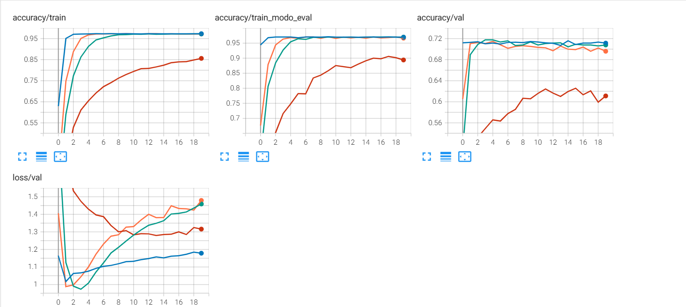
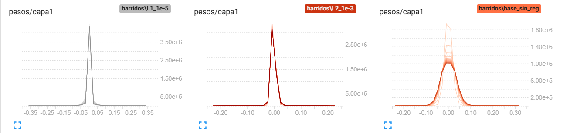

# Redes Neuronales / Deep Learning – Trabajos prácticos

Alumno: Santiago · Profesor: Carlos Selmo

| TP | Tema | Notebook |
|---|---|---|
| TP3 | Regularización (L1, L2, L1+L2, Dropout, BatchNorm) en la clasificación de 20 Newsgroups | [`TP3_Regularizacion_20Newsgroups.ipynb`](TP3_Regularizacion_20Newsgroups.ipynb) |

---

## TP3 – Regularización en la clasificación de 20 Newsgroups

**Consigna:** incluir como hiperparámetros del TP de clasificación de 20 Newsgroups la regularización L1/L2/L1+L2, Dropout y BatchNormalization, siguiendo las recomendaciones de clase, y analizar valores absolutos de pesos, tiempos de entrenamiento, valores de learning rate y ruido en las curvas de aprendizaje.

**Qué se hizo**

1. División train / validación / test una sola vez (estratificada, semilla fija). El TF-IDF se ajusta **solo con train**.
2. **Barridos controlados**: sobre una red 2x512 sin regularización (varianza alta en el TP2) se cambia una técnica por vez. Son 21 configuraciones × 3 semillas, todas con 20 épocas.
3. **Búsqueda con Optuna** de todos los hiperparámetros juntos: preprocesamiento, arquitectura, optimizador y regularización. Sampler TPE con semilla fija y MedianPruner.
4. **Entrenamiento final** con early stopping sobre validación y evaluación en test al final, comparado con la mejor red del TP2 bajo el mismo protocolo.

**Resultados principales**

- Red base 2x512 sin regularización: varianza alta (train ≈0,97, validación 0,711 en su mejor época).
- **L1 y L2** no mejoraron la validación con ningún λ probado. Con L2 ≥ 1e-2 o L1 ≥ 1e-4 la red deja de aprender (0,053, igual que adivinar). L1 deja los pesos esparsos (hasta 73% casi en cero) y L2 los achica a todos.
- **Dropout** mejoró poco pero en las 3 semillas (0,715–0,719) y necesitó más épocas. **BatchNorm** convergió en 1 época y, junto con dropout 0,5, dio la mejor red 2x512 (0,734).
- Subir el learning rate ×10 empeoró todas las variantes; BatchNorm fue la que mejor lo toleró.
- Optuna (48 trials) eligió 1 capa de 256, leaky_relu, Adam y dropout 0,51, sin L1/L2 ni BN: validación 0,752.
- **Test (mediana de 3 semillas): 0,684**, contra 0,681 de la mejor red del TP2 evaluada con el mismo protocolo.

### Estructura

```
├── README.md
├── requirements.txt                          # versiones exactas (lo genera el notebook)
├── TP3_Regularizacion_20Newsgroups.ipynb     # notebook ejecutado, con outputs
├── resultados_barridos_completo.json         # resultados crudos de los barridos
└── img/                                      # capturas de TensorBoard
```

### Cómo reproducirlo

Requiere Python 3.13 (Anaconda). Desde el **Anaconda Prompt**, en esta carpeta:

```
pip install -r requirements.txt
```

Después abrir el notebook, poner `MODO_RAPIDO = False` en la celda de configuración y correr todo (≈3 h en CPU). Con `MODO_RAPIDO = True` corre una versión corta en pocos minutos, para comprobar que funciona.

No se usan `torchvision` ni `torchaudio`, por eso no están en `requirements.txt`.

### TensorBoard y MLflow

Desde el Anaconda Prompt, en esta carpeta, una vez corrido el notebook:

```
tensorboard --logdir runs
mlflow ui
```

TensorBoard queda en http://localhost:6006 y MLflow en http://localhost:5000. Las carpetas `runs/` y `mlruns/` no se suben al repo porque se regeneran al correr el notebook.




